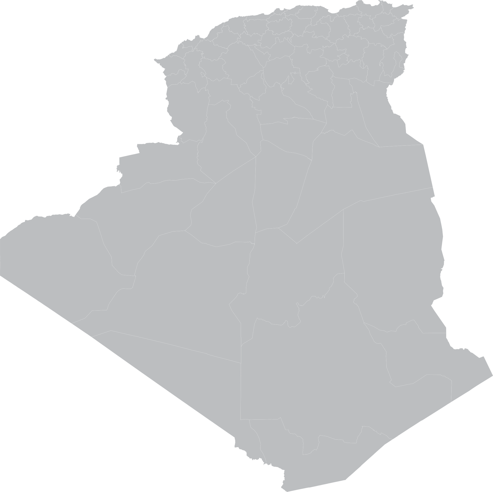

# Algeria Map - 69 Wilayas SVG

An accurate, multilingual SVG map of Algeria's 69 administrative divisions (wilayas), with names in Arabic and Latin script, plus the same boundaries as GeoJSON.



## Overview

This project provides a scalable vector map of Algeria's 69 wilayas (provinces), up to date with Law 26-06 of 4 April 2026, which created wilayas 59 to 69. Each wilaya is a separate path element carrying its official code and its names in Arabic and Latin script. That makes the map ready for interactive web applications, data visualization and geographic information systems.

The boundaries come from OpenStreetMap and are corrected so that every commune lies in the wilaya the law assigns it to.

## Features

- **Complete Coverage**: All 69 wilayas, numbered as in Presidential Decree 26-206
- **Real Geography**: Boundaries from OpenStreetMap, with neighbours sharing exactly the same border (no gaps or overlaps)
- **Multilingual Support**: Names in both Arabic (official) and Latin scripts
- **GeoJSON Included**: The same polygons in longitude/latitude for Leaflet, Mapbox, D3 or QGIS
- **Map-Ready SVG**: Drawn in Web Mercator, so it lines up with web map tiles
- **Scalable**: Vector format ensures perfect quality at any size
- **Accessible**: Semantic IDs and data attributes for easy DOM manipulation
- **Reproducible**: One script rebuilds everything from OpenStreetMap

## Files

| File | Description |
| --- | --- |
| [`map-algeria-69-wilayas.svg`](map-algeria-69-wilayas.svg) | The map: 69 paths with `id`, `data-name`, `data-name-latin`, `data-name-ar` |
| [`data/algeria-69-wilayas.geojson`](data/algeria-69-wilayas.geojson) | The same boundaries in longitude/latitude |
| [`data/wilayas.csv`](data/wilayas.csv) | Codes, names and the wilaya each new one was carved from |
| [`scripts/build_map.py`](scripts/build_map.py) | Rebuilds the SVG and GeoJSON from OpenStreetMap |

## Documentation

- **[Usage Examples](docs/USAGE_EXAMPLES.md)** - HTML, JavaScript, React examples and styling
- **[Wilayas List](docs/WILAYAS_LIST.md)** - Complete table of all 69 wilayas
- **[Technical Specifications](docs/TECHNICAL_SPECS.md)** - File formats, data source, corrections and rebuilding
- **[Integration Guide](docs/INTEGRATION.md)** - Leaflet.js and D3.js integration
- **[Contributing](docs/CONTRIBUTING.md)** - Guidelines, roadmap, and changelog
- **[FAQ](docs/FAQ.md)** - Frequently asked questions and resources

## Quick Start

```html
<!DOCTYPE html>
<html>
<head>
    <style>
        #algeria-map-69-wilaya path {
            fill: #bcbec0;
            stroke: #333;
            cursor: pointer;
            transition: fill 0.3s;
        }
        #algeria-map-69-wilaya path:hover {
            fill: #2ecc71;
        }
    </style>
</head>
<body>
    <div id="map-container"></div>
    <script>
        fetch('map-algeria-69-wilayas.svg')
            .then(response => response.text())
            .then(svg => {
                document.getElementById('map-container').innerHTML = svg;
            });
    </script>
</body>
</html>
```

See [Usage Examples](docs/USAGE_EXAMPLES.md) for more detailed implementations.

## License

The code and documentation are licensed under the MIT License (see [LICENSE](LICENSE)):

```text
MIT License

Copyright (c) 2026 Algeria Map SVG Project

Permission is hereby granted, free of charge, to any person obtaining a copy
of this software and associated documentation files (the "Software"), to deal
in the Software without restriction, including without limitation the rights
to use, copy, modify, merge, publish, distribute, sublicense, and/or sell
copies of the Software, and to permit persons to whom the Software is
furnished to do so, subject to the following conditions:

The above copyright notice and this permission notice shall be included in all
copies or substantial portions of the Software.

THE SOFTWARE IS PROVIDED "AS IS", WITHOUT WARRANTY OF ANY KIND, EXPRESS OR
IMPLIED, INCLUDING BUT NOT LIMITED TO THE WARRANTIES OF MERCHANTABILITY,
FITNESS FOR A PARTICULAR PURPOSE AND NONINFRINGEMENT. IN NO EVENT SHALL THE
AUTHORS OR COPYRIGHT HOLDERS BE LIABLE FOR ANY CLAIM, DAMAGES OR OTHER
LIABILITY, WHETHER IN AN ACTION OF CONTRACT, TORT OR OTHERWISE, ARISING FROM,
OUT OF OR IN CONNECTION WITH THE SOFTWARE OR THE USE OR OTHER DEALINGS IN THE
SOFTWARE.
```

The boundary geometry in the SVG and GeoJSON is © [OpenStreetMap contributors](https://www.openstreetmap.org/copyright), available under the Open Database License (ODbL) 1.0. Credit OpenStreetMap when you use it; see [DATA_LICENSE.md](DATA_LICENSE.md).

## Acknowledgments

- Boundaries: © OpenStreetMap contributors
- Wilaya list and numbering: Law 19-12 (2019), Law 26-06 (2026) and Presidential Decree 26-206
- Arabic names follow official government designations
- Latin transliterations follow standard conventions

## Support

- **Issues**: [GitHub Issues](https://github.com/chemsallioua/Algeria69WilayaMap/issues)
- **Discussions**: [GitHub Discussions](https://github.com/chemsallioua/Algeria69WilayaMap/discussions)

---

**Made with ❤️ for Algeria** | **الجزائر**

If you find this useful, please ⭐ star the repository!
